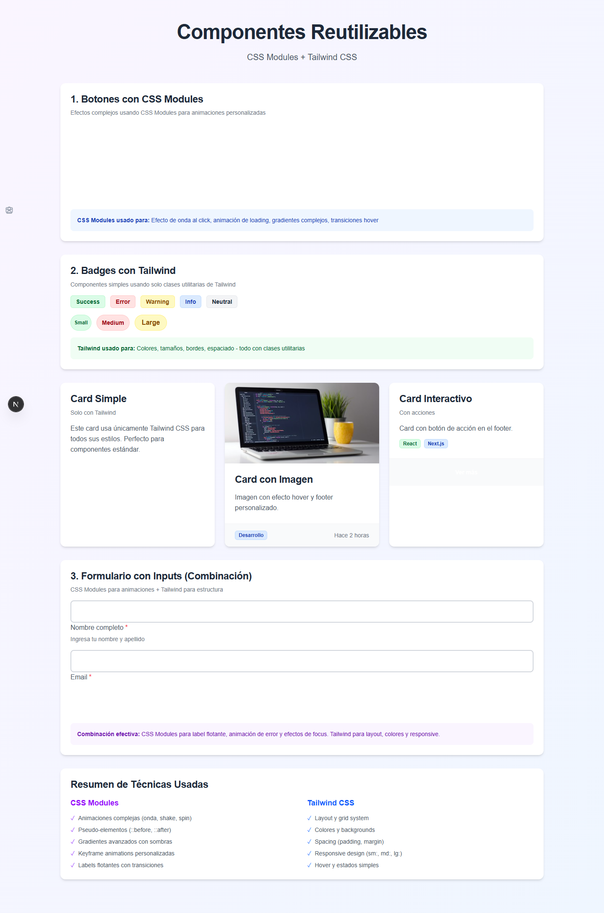
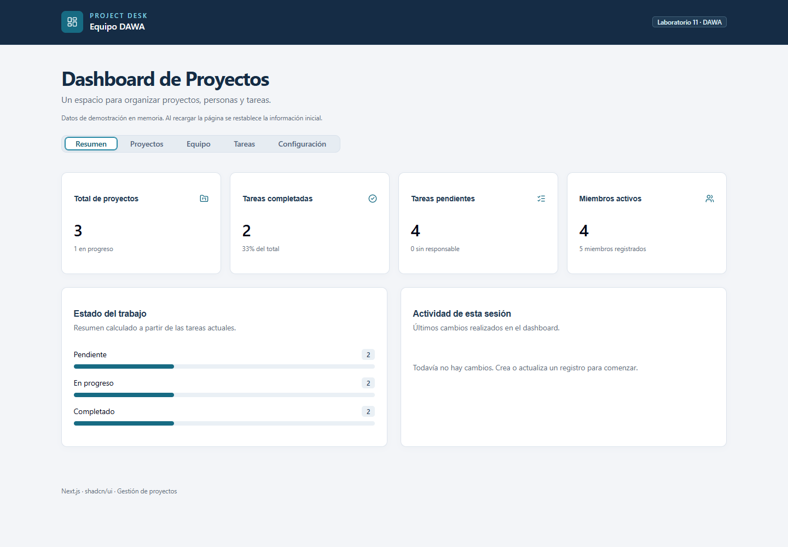
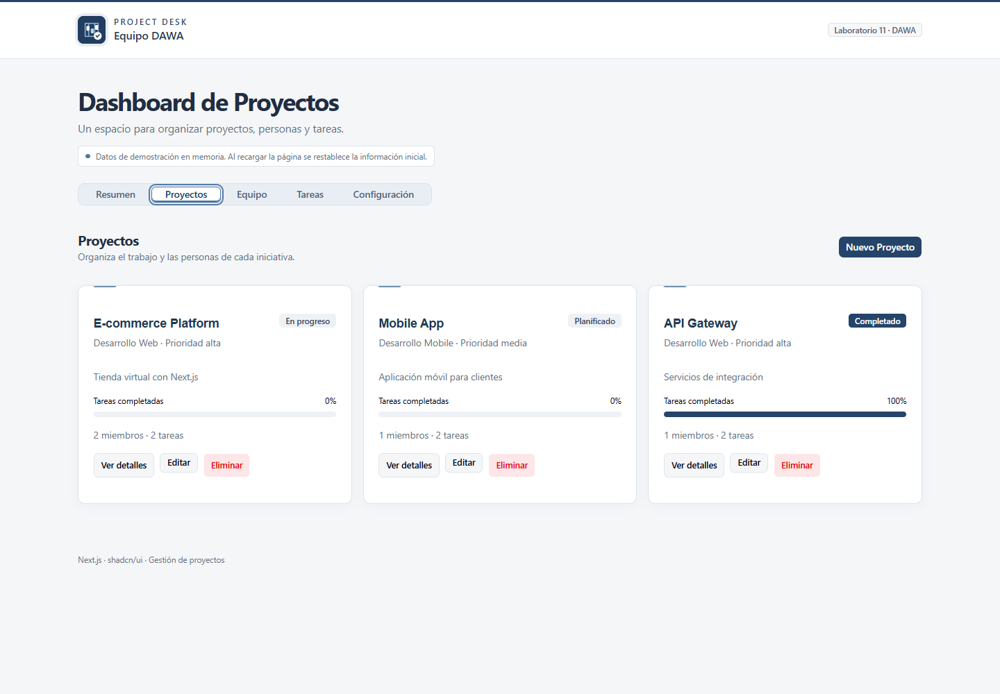
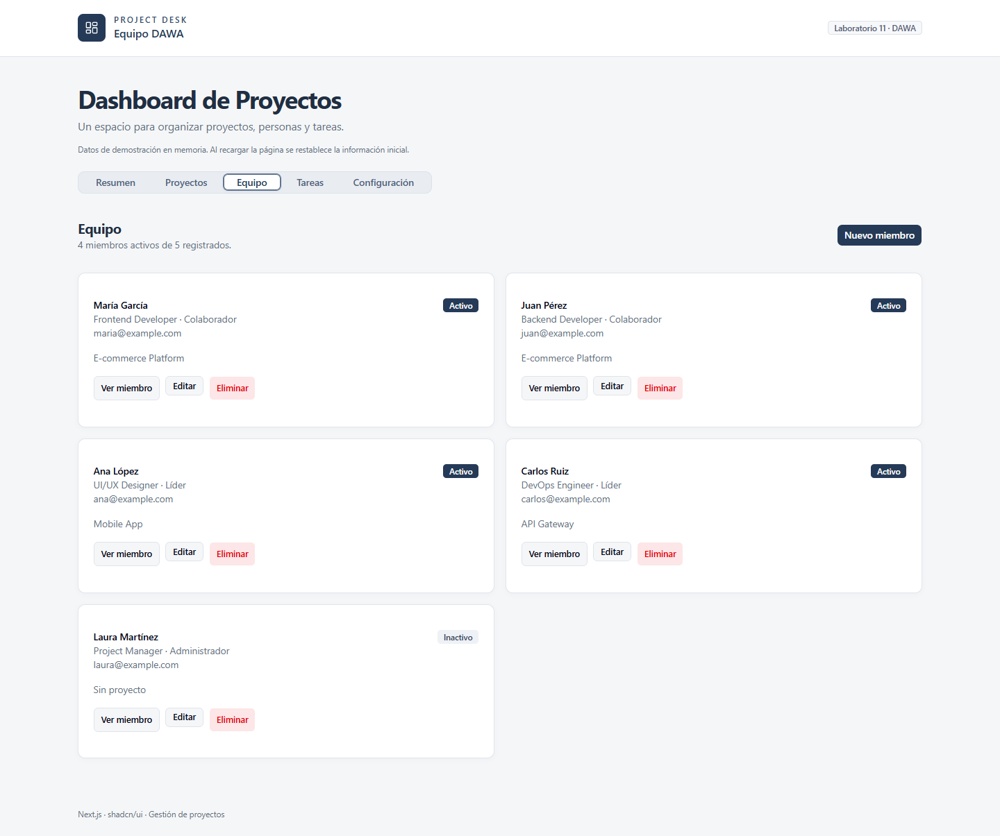
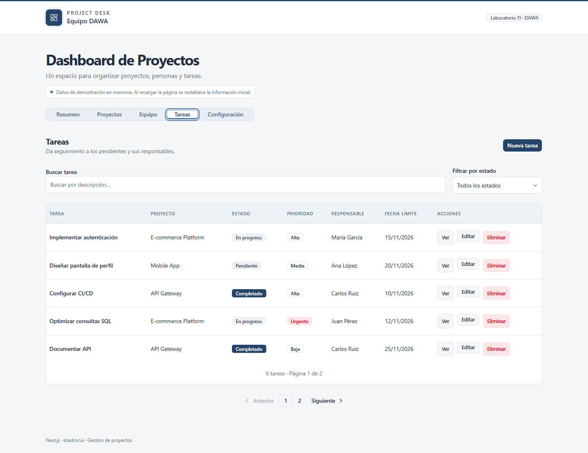
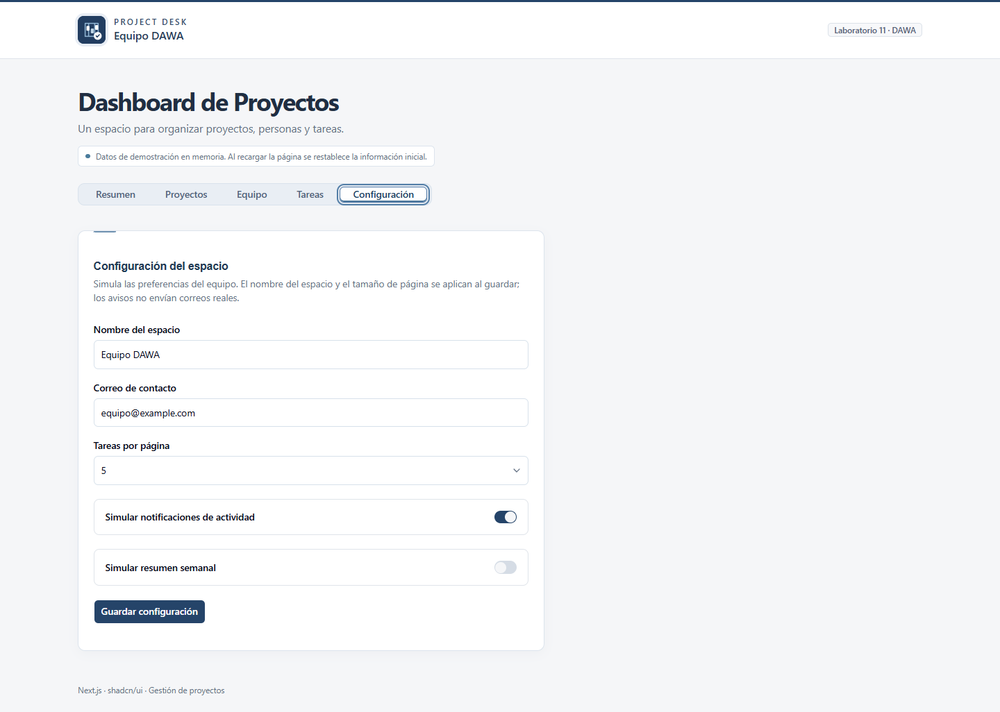
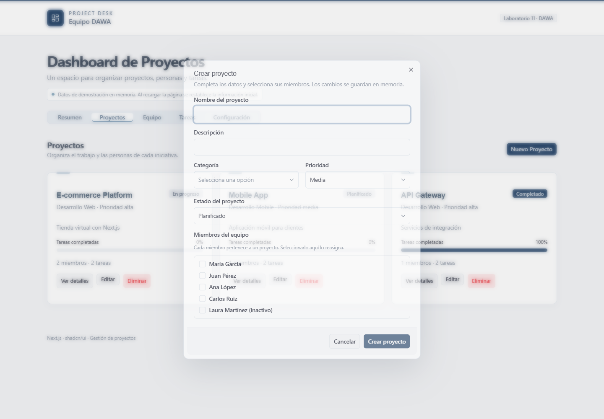
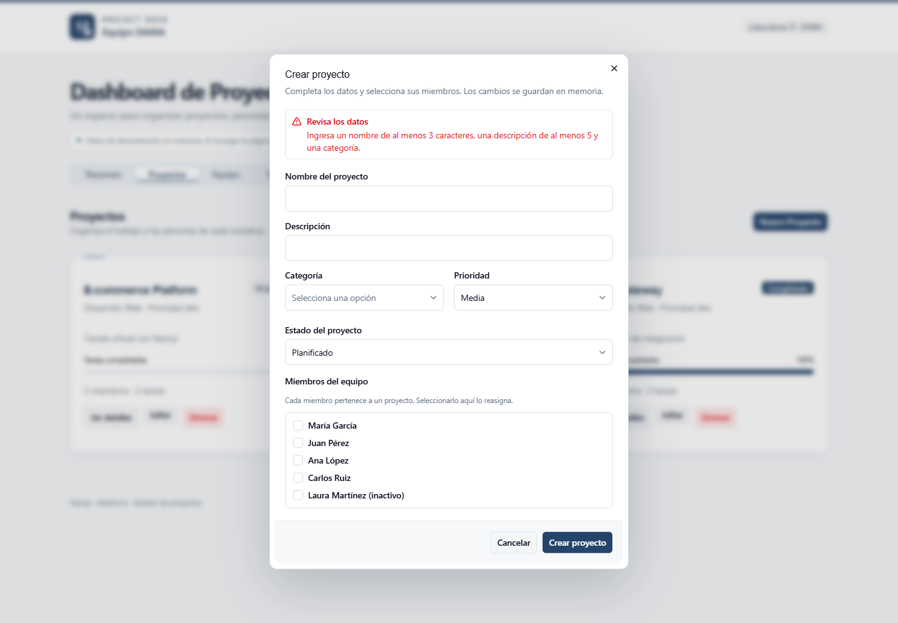
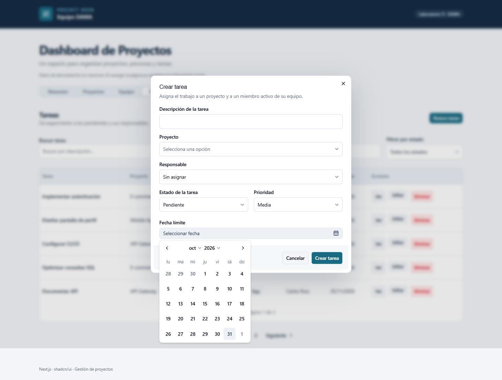

# Project Desk · Componentes y estilización

Proyecto académico de Desarrollo de Aplicaciones Web Avanzado (DAWA), Semana 11. Reúne dos aplicaciones independientes: una galería de componentes reutilizables y un dashboard para organizar proyectos, miembros del equipo y tareas.

El objetivo es aplicar CSS Modules, Tailwind CSS y shadcn/ui en interfaces reutilizables y desarrollar la lógica de gestión con React y TypeScript.

## Aplicaciones

| Aplicación | Propósito | Ruta |
| --- | --- | --- |
| `next-components-styling` | Demostración de botones, tarjetas, badges y campos de formulario con CSS Modules y Tailwind CSS. | `/styling` |
| `next-shadcn-ui` | Dashboard Project Desk con gestión de proyectos, equipo, tareas y configuración. | `/dashboard` |

## Tecnologías

- Next.js 16.4.3 con App Router y Turbopack.
- React 19.3 y TypeScript 5.
- Tailwind CSS 4 y CSS Modules.
- shadcn/ui con componentes basados en Radix UI.
- React Day Picker y date-fns para selección y presentación de fechas.
- Lucide React para iconos y ESLint 9 para análisis del código.

Cada aplicación tiene su propio `package.json` y `package-lock.json`.

## Requisitos

- Node.js 22 y npm. El proyecto se verificó con Node.js 22.20.0 y npm 10.9.3.
- Git para clonar el repositorio.
- Un navegador actualizado.

## Instalación y ejecución

```powershell
git clone https://github.com/C5-PHO/DAWA-S11.git
cd DAWA-S11
```

### Galería de componentes

```powershell
cd next-components-styling
npm ci
npm run dev
```

Abrir `http://localhost:3000/styling`.

### Dashboard Project Desk

Desde la raíz del repositorio:

```powershell
cd next-shadcn-ui
npm ci
npm run dev
```

Abrir `http://localhost:3000/dashboard`. La ruta `/` redirige al dashboard.

Para ejecutar las dos aplicaciones simultáneamente, usa dos terminales y un puerto distinto para la segunda:

```powershell
npm run dev -- --port 3001
```

En ese caso, usa `http://localhost:3001` y la ruta correspondiente.

## Variables de entorno

Las aplicaciones actuales no requieren archivos `.env`, claves ni servicios externos. El dashboard utiliza datos de demostración en memoria.

## Comandos

Ejecutar desde la carpeta de cada aplicación:

| Comando | Función |
| --- | --- |
| `npm ci` | Instalar las dependencias según el archivo de bloqueo. |
| `npm run dev` | Iniciar el servidor de desarrollo. |
| `npm run lint` | Analizar el código con ESLint. |
| `npm run build` | Generar y comprobar la compilación de producción. |
| `npm start` | Servir la compilación creada previamente con `npm run build`. |

## Funcionalidades y uso

### Componentes reutilizables

- **Button:** variantes, tamaños, estados deshabilitado y de carga, y efecto de onda.
- **Card:** contenido, imágenes y pie opcionales, con respuesta visual al pasar el cursor.
- **Badge:** variantes de estado, tamaños y formas.
- **Input:** etiqueta flotante, icono opcional y mensajes de ayuda o error.
- Página de demostración con validación de correo y formulario de ejemplo.

Tailwind CSS resuelve tamaños, colores, distribución y espaciado. CSS Modules encapsula efectos y animaciones particulares de los componentes.

### Dashboard

| Sección | Funciones |
| --- | --- |
| Resumen | Métricas calculadas con los registros actuales, distribución de estados y actividad de la sesión. |
| Proyectos | Crear, consultar detalles, editar, asignar miembros y eliminar con confirmación. |
| Equipo | Crear, consultar, editar y eliminar miembros; registrar rol, nombre, correo único, cargo, nacimiento, teléfono, proyecto y estado activo. |
| Tareas | Crear, consultar, editar y eliminar tareas; asignar proyecto y responsable, definir estado, prioridad y fecha límite; buscar, filtrar y paginar. |
| Configuración | Guardar nombre del espacio, correo de contacto, cantidad de tareas por página y preferencias simuladas. |

Para comenzar, crea un proyecto, registra miembros activos y asígnalos al proyecto. Después crea tareas y selecciona sus responsables. Las métricas del resumen se actualizan al modificar los registros.

Los formularios muestran errores con **Alert**, las operaciones simuladas muestran **Spinner**, las fechas se eligen con **Calendar** y la tabla usa **Pagination**.

### Relaciones y límites

- Los datos se mantienen en memoria. Recargar la página restablece los registros iniciales; no existe persistencia ni backend.
- Cada miembro pertenece como máximo a un proyecto. Reasignarlo desde otro proyecto libera sus tareas incompatibles.
- Solo los miembros activos del proyecto pueden recibir sus tareas. Desactivar, reasignar o eliminar un miembro deja sin responsable las tareas afectadas.
- Eliminar un proyecto elimina sus tareas y deja a sus miembros sin proyecto. El diálogo de confirmación informa este efecto.
- Los identificadores nuevos son UUID. Las operaciones simulan una espera de 650 ms.
- Las preferencias de notificaciones y reporte semanal son simuladas: no envían correos.

## Estructura

```text
DAWA-S11/
├── next-components-styling/
│   ├── src/app/styling/page.tsx
│   ├── src/components/cards/Card.tsx
│   ├── src/components/ui/
│   └── docs/capturas/
└── next-shadcn-ui/
    ├── public/project-desk.svg
    ├── src/app/dashboard/page.tsx
    ├── src/app/icon.svg
    ├── src/components/dashboard/
    │   ├── dashboard.tsx
    │   ├── overview-panel.tsx
    │   ├── projects-panel.tsx
    │   ├── project-editor.tsx
    │   ├── team-panel.tsx
    │   ├── tasks-panel.tsx
    │   ├── settings-panel.tsx
    │   └── shared.tsx
    ├── src/components/ui/
    ├── src/lib/dashboard/model.ts
    └── docs/capturas/
```

`dashboard.tsx` concentra el estado y las operaciones. Los paneles presentan cada sección; `shared.tsx` contiene campos y confirmaciones compartidas. `model.ts` define los tipos, datos iniciales y utilidades.

## Identidad visual

Project Desk usa una paleta azul marino con superficies blancas y grises neutros. El logo representa un tablero de tareas con una marca de completado y se aplica también como icono de la pestaña. La interfaz incluye adaptación a pantallas pequeñas, foco visible y respeto a movimiento reducido.

## Verificación

Se comprobaron las compilaciones de ambas aplicaciones y el lint del dashboard. Las pruebas de navegador del dashboard cubrieron altas, ediciones, detalles, eliminaciones, correo duplicado, calendario, paginación, configuración, métricas y relaciones entre registros. La revisión del ejercicio de componentes detectó dos advertencias de lint del código de la guía: uso de `` y una variable sin usar.

## Despliegue en Vercel

Importar este repositorio y elegir la aplicación como **Root Directory**:

- `next-shadcn-ui` para publicar Project Desk.
- `next-components-styling` para publicar la galería como proyecto independiente.

Seleccionar **Next.js** como framework y conservar los comandos predeterminados de instalación y compilación. No se requieren variables de entorno. Cada aplicación se despliega por separado; la raíz del repositorio contiene ambas.

## Capturas

### Galería de componentes



### Resumen



### Proyectos



### Equipo



### Tareas



### Configuración



### Formulario y validación




### Calendario


