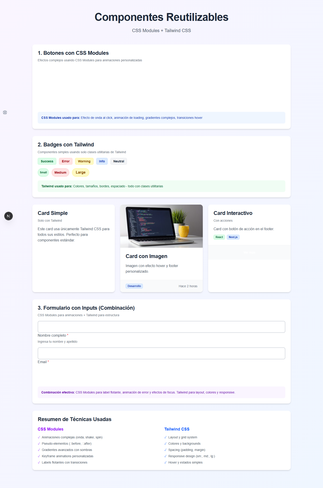

# Componentes reutilizables — DAWA, Semana 11

Ejercicio de componentes con Next.js, TypeScript, CSS Modules y Tailwind CSS.

```powershell
npm install
npm run dev
```

Abrir `http://localhost:3000/styling`.

## Captura


