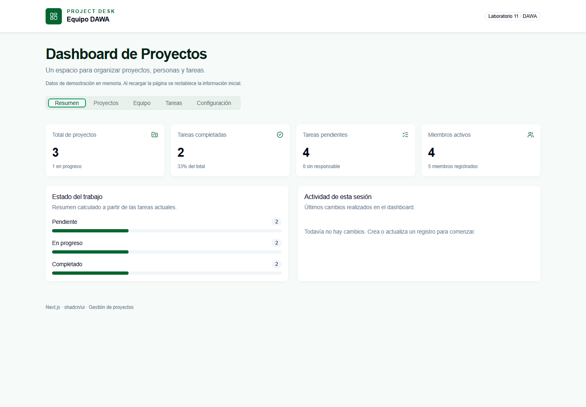
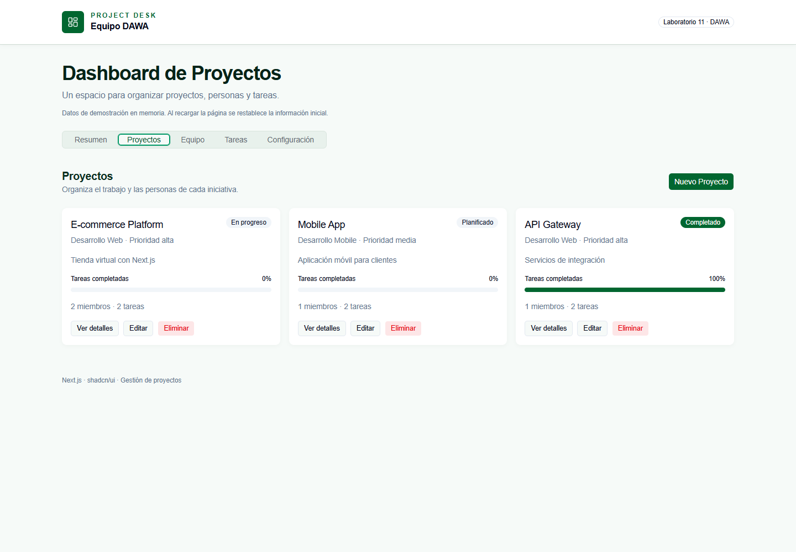
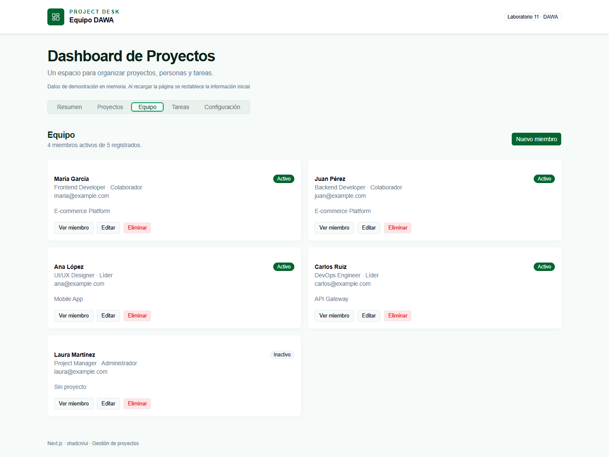
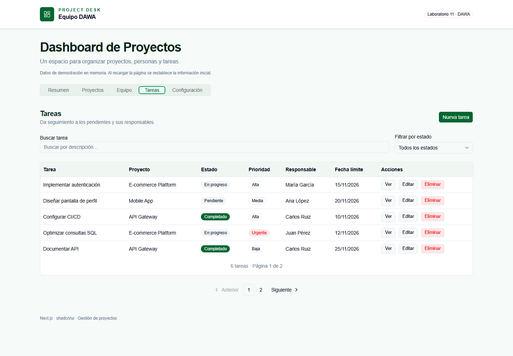
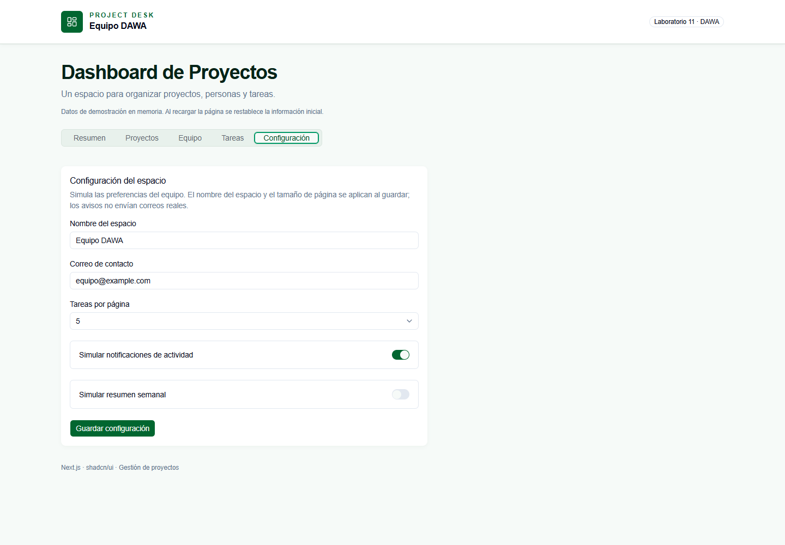
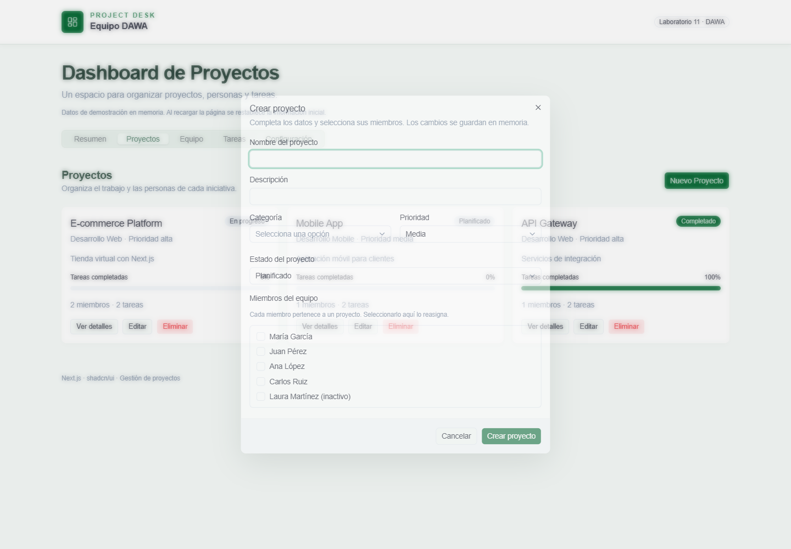
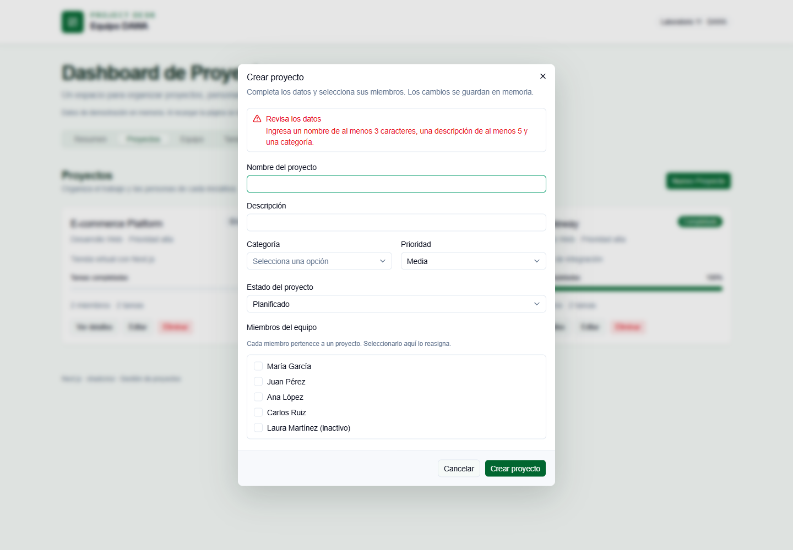
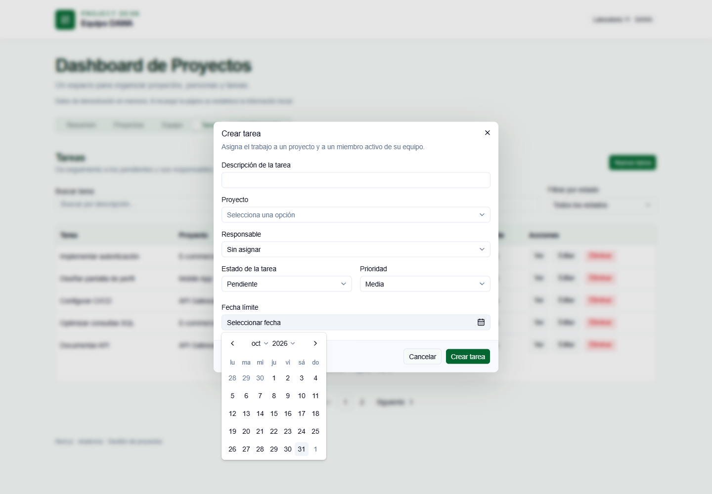

# Dashboard de Proyectos — DAWA, Semana 11

Aplicación Next.js del ejercicio 2 y la tarea final del GLAB: gestión de proyectos, miembros y tareas con componentes reutilizables de shadcn/ui.

## Tecnologías

Next.js 16, React 19, TypeScript, Tailwind CSS 4, shadcn/ui basado en Radix, React Day Picker y date-fns.

## Ejecución local

Desde esta carpeta:

```powershell
npm install
npm run dev
```

Abrir `http://localhost:3000/dashboard`. La raíz redirige al dashboard. Si el puerto está ocupado, usar la dirección que indique Next.js.

```powershell
npm run lint
npm run build
npm start
```

No se requieren variables de entorno ni servicios externos.

## Funciones

- **Resumen:** métricas calculadas con los datos actuales, distribución de tareas y actividad de la sesión.
- **Proyectos:** creación, lectura, edición, detalles, selección de miembros y eliminación confirmada.
- **Equipo:** CRUD con identificador automático, rol, nombre, correo único, cargo, nacimiento, teléfono, proyecto y estado activo.
- **Tareas:** CRUD con descripción, proyecto, estado, prioridad, responsable y fecha límite. Incluye búsqueda, filtro por estado y paginación real.
- **Configuración:** nombre del espacio, correo de contacto, tamaño de página y preferencias simuladas de notificaciones y reporte semanal.
- **Componentes exigidos:** Spinner durante las operaciones simuladas, Alert para validaciones, Calendar para fechas y Pagination en Tareas.
- Tema verde esmeralda, diseño adaptable, campos etiquetados y respeto a movimiento reducido.

## Datos y relaciones

Los datos iniciales son de demostración y se mantienen en memoria durante la sesión. Recargar la página los restablece; no existe persistencia ni backend. Las operaciones simulan una espera de 650 ms y bloquean el envío repetido.

Cada miembro puede pertenecer a un proyecto. Asignarlo desde otro proyecto lo reasigna; las tareas incompatibles quedan sin responsable. Solo los miembros activos del proyecto pueden recibir tareas nuevas. Desactivar, cambiar de proyecto o eliminar un miembro libera sus asignaciones afectadas. Eliminar un proyecto elimina sus tareas y deja a sus miembros sin proyecto; el diálogo informa este efecto antes de confirmar.

Los identificadores son UUID automáticos. Se usa `projectId` para el campo de proyecto y `dateline` para la fecha límite de la tarea, corrigiendo el error tipográfico `prjectId` de la guía.

## Estructura

- `src/app/dashboard/page.tsx`: entrada de la ruta.
- `src/components/dashboard/dashboard.tsx`: estado compartido y operaciones en memoria.
- `src/components/dashboard/*-panel.tsx`: interfaces de cada sección.
- `src/components/dashboard/shared.tsx`: validaciones visuales, campos, calendario y confirmación de borrado.
- `src/lib/dashboard/model.ts`: tipos, datos iniciales y utilidades.
- `src/components/ui/`: componentes shadcn/ui.

## Evidencias pendientes

Tomar capturas reales del resumen, operaciones CRUD, validaciones, calendario, paginación y configuración. El despliegue en Vercel y las conclusiones del documento son entregables separados; este repositorio no los da por realizados.

## Capturas de la aplicación

Las imágenes muestran las pantallas con datos de demostración.









